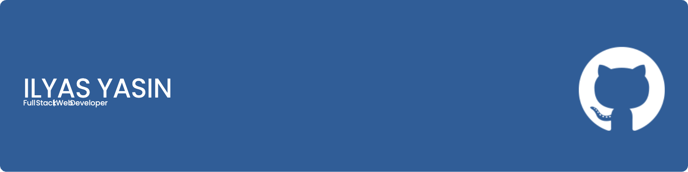

# 👋 Halo, Saya Ilyas Yasin, S.Tr.Kom

**Full-Stack Software Developer • Application Architect • IT Technical Consultant**

*Merancang arsitektur perangkat lunak berskala besar, sistem pemerintahan terintegrasi, dan ekosistem e-commerce dengan performa tinggi.*

 

---

## 👨‍💻 Tentang Saya

Saya adalah **Full-Stack Developer & Application Architect** yang berbasis di Jakarta, Indonesia. Berpengalaman membangun sistem kritis berskala nasional, platform e-commerce multi-tenant, integrasi pembayaran perbankan (SNAP BI), hingga infrastruktur *microservices* yang aman dan efisien.

- 🔭 **Fokus Saat Ini:** Pengembangan sistem manajemen regulasi (LDMS), integrasi tanda tangan elektronik tersertifikasi (BSrE BSSN), serta optimalisasi ekosistem logistik dan pembayaran real-time.
- 🏗️ **Keahlian Utama:** Arsitektur Microservices, Hybrid Mobile Apps, Custom Rich-Text Collaboration Engine, Modernisasi Framework (Laravel 8 → 13), Pengujian Otomatis & UAT, dan System Security (VAPT).
- 💸 **Senang Mengerjakan:** alur uang yang *tidak boleh salah* — idempotency, rekonsiliasi, jurnal double-entry, dan penanganan jawaban API yang tidak pasti.
- 💡 **Prinsip Kerja:** *"Koding yang bersih, terukur, aman, dan selalu siap untuk dikembangkan."*

---

## 🏆 Sorotan Pencapaian

> Angka di bawah dihitung dari repositori LDMS (CHANGELOG, kode, dan riwayat git) per **12 November 2026**.

<table>
  <tr>
    <td align="center" width="25%"><h2>780</h2>rilis terdokumentasi (SemVer) 13 Jul – 12 Nov 2026</td>
    <td align="center" width="25%"><h2>94</h2>tabel basis data dirapikan menjadi 11 baseline migration</td>
    <td align="center" width="25%"><h2>245</h2>test method di 51 berkas termasuk suite UAT otomatis</td>
    <td align="center" width="25%"><h2>147</h2>skenario UAT di 19 form (805 langkah uji)</td>
  </tr>
</table>

- ⬆️ **Memodernisasi stack produksi secara bertahap:** Laravel **8.83 → 9 → 10 → 11 → 13.38**, Livewire **2 → 3**, PHP **8.2 → 8.3**, Passport **10 → 13**, spatie/permission **4 → 6** — dijaga *route smoke test* dan *baseline render* 30 komponen Livewire agar tidak ada regresi diam-diam.
- 🛡️ **Menutup celah keamanan kritis:** patch kerentanan Laravel (bypass autentikasi, CVSS 9.2) dan PHP (RCE tanpa autentikasi, CVSS 9.2), triase **89 advisory Composer pada 23 paket** (Applies / Latent / N/A), serta hardening *broken access control* hingga level dokumen.
- ✍️ **Membangun mesin penyusunan dokumen hukum kolaboratif** — CKEditor 5 kustom (komentar inline, *track changes*, riwayat revisi, bandingkan versi ala redline) dan editor Collabora Online (WOPI) untuk naskah Peraturan Lembaga.
- 🔏 **Alur tanda tangan elektronik BSrE end-to-end:** paraf koordinasi berjenjang, penomoran otomatis dan lokal per jenis, pengabsahan salinan, hingga penayangan JDIH — termasuk *preflight* agar nomor tidak bocor bila layanan BSrE sedang tidak tersedia.
- 🧪 **Suite UAT otomatis yang aman dijalankan di atas salinan data produksi** (transaksi di-rollback, disk/MinIO/BSrE/email dipalsukan) untuk alur Non-SK, SK, Instruksi Kerja, dan Keputusan Penunjukan.
- 📚 **Kedisiplinan rilis:** setiap perubahan tercatat pada changelog format *Keep a Changelog* + *Semantic Versioning* (±7.700 baris), dilengkapi Design System, README pengguna & developer, Buku Panduan Pengguna, dan koleksi Postman API.

---

## 🛠️ Tech Stack & Infrastruktur

### **Backend & Core Languages**

### **Frontend & Mobile**

### **Database, Storage, Realtime & Message Broker**

### **Identitas, Dokumen & Pengujian**

### **DevOps, Server & Security**

---

## 🚀 Proyek & Arsitektur Pilihan

<table>
  <tr>
    <td width="50%" valign="top">
      <h3>🏛️ Government & Enterprise Systems</h3>
      <ul>
        <li>
          <strong>Legal Drafting Management System (LDMS / BATUKARU)</strong> 
          Sistem penyusunan produk hukum kolaboratif dengan <em>custom CKEditor 5 engine</em> (inline comments, revision history, custom PDF pagination), integrasi BSrE (BSSN) E-Sign, SIASN BKN, JDIH, dan arsitektur microservices. <a href="#-ldms--yang-sudah-saya-kerjakan">Lihat yang sudah dikerjakan ↓</a>
        </li>
        <li>
          <strong>E-Office & Epicentrum LKPP</strong> 
          Manajemen persuratan, kehadiran berbasis geolokasi, modul SPT/LHKPN, serta integrasi penyimpanan objek MinIO & SSO (Apereo CAS / Microsoft 365).
        </li>
        <li>
          <strong>Satu Data & HR Management System</strong> 
          Portal integrasi data kebijakan publik, manajemen merit system pegawai, riwayat karier, serta sistem tiket konsultasi multi-PIC.
        </li>
      </ul>
    </td>
    <td width="50%" valign="top">
      <h3>🛒 E-Commerce & Fintech Ecosystem</h3>
      <ul>
        <li>
          <strong>Sahabat Sayur Ecosystem</strong> 
          Platform e-commerce, ojek online & logistik multi-tenant dengan pelacakan real-time dan aplikasi Android (Capacitor). <a href="#-sahabat-sayur--yang-sudah-saya-kerjakan">Lihat yang sudah dikerjakan ↓</a>
        </li>
        <li>
          <strong>SNAP BI & Payment Gateway Integration</strong> 
          Implementasi standar <strong>BRI SNAP BI</strong> (Dynamic QRIS, webhook mutasi intrabank/interbank, disbursement OTP) serta integrasi transfer multi-bank via FLIP API.
        </li>
        <li>
          <strong>Enterprise POS & Manufacturing Apps</strong> 
          Sistem POS asuransi (Pacific & Bhineka Insurance dengan Oracle), aplikasi POS retail (Laravel + React Inertia), serta sistem monitoring jadwal produksi kain & konversi warna CIELAB.
        </li>
      </ul>
    </td>
  </tr>
</table>

---

## 🏛️ LDMS — Yang Sudah Saya Kerjakan

**Legal Drafting Management System (nama kode BATUKARU)** adalah aplikasi internal LKPP untuk **menyusun, memeriksa, menyetujui, menandatangani secara elektronik (TTE BSrE), menomori, dan menayangkan produk hukum** — Peraturan, Keputusan, Surat Edaran, SK Kepegawaian (beserta Petikan), Instruksi Kerja, dan KAK — lengkap dengan portal publik dan API untuk sistem lain.

### 📊 Skala & Metrik Proyek

| Metrik | Angka | Keterangan |
| :--- | :--- | :--- |
| **Rilis terdokumentasi** | **780 versi** | `1.0.0` → `1.86.542`, 13 Jul – 12 Nov 2026 (≈ 6 rilis per hari kerja) |
| **Catatan perubahan** | **±1.100 entri** | ≥ 264 fitur baru · ≥ 455 peningkatan · ≥ 310 perbaikan · 63 catatan keamanan |
| **Kontribusi commit** | **248 dari 249** | commit pada repositori sejak 1 Jul 2026 |
| **Skala kode** | **±70 ribu baris PHP · ±110 ribu baris Blade** | 89 controller · 69 service · 91 model · 33 komponen Livewire · 439 view |
| **Rute aplikasi** | **570+ rute** | web, dokumen, SK, Perlem, SOP, dan API terpisah per berkas rute |
| **Skema basis data** | **94 tabel** | 83 migration lama → 11 baseline migration, aman untuk DB produksi eksisting |
| **Pengujian** | **245 test method / 51 berkas** | termasuk 132 test UAT otomatis, *route smoke*, dan baseline Livewire |
| **UAT Revisi November 2026** | **19 form · 147 skenario · 805 langkah** | 5 modul: Non-SK, SK Kepegawaian, Instruksi Kerja, Keputusan Penunjukan, Helpdesk Biro Hukum |

### 🧩 Modul yang Dibangun

<table>
  <tr>
    <td width="33%" valign="top">
      <h4>📜 Produk Hukum & Alur Persetujuan</h4>
      <ul>
        <li><b>Non-SK</b>: draft, tim penyusun/pemeriksa, DIM, bahan kajian, notulensi, lampiran</li>
        <li><b>SK Kepegawaian</b> dari template: daftar pegawai (drag &amp; drop), Petikan per pegawai, <b>tanda tangan 2 tahap</b> (Keputusan → Petikan), distribusi &amp; tembusan otomatis</li>
        <li><b>Instruksi Kerja</b> &amp; <b>KAK</b>: pemeriksaan berjenjang, tembusan ke Kepala Biro Hukum, referensi mencabut/mengganti/mengubah</li>
        <li><b>Keputusan Penunjukan PA/KPA/PB/KPB</b> dengan penomoran lokal per jenis &amp; tahun</li>
        <li><b>Paraf koordinasi berjenjang</b> JPT Pratama → JPT Madya, PIC &amp; kolaborator, pengambilalihan Plt/Plh</li>
        <li><b>Monitoring TTD</b> Peraturan &amp; SK dengan timeline, filter, dan status Ditolak</li>
      </ul>
    </td>
    <td width="33%" valign="top">
      <h4>✍️ Editor Kolaboratif & Dokumen</h4>
      <ul>
        <li><b>CKEditor 5 kustom</b>: komentar inline (DB-backed), saran perubahan, riwayat revisi, layar penuh, Edit HTML</li>
        <li><b>Bandingkan Versi</b> (redline): sandingkan A|B &amp; catatan tepi</li>
        <li><b>Word Tools</b>: import dari Word, pratinjau, terjemah, dan ekspor Word via microservice LibreOffice/unoserver</li>
        <li><b>Cek ejaan dwibahasa</b> (ID + EN) dan grammar checker Inggris, offline</li>
        <li><b>Asisten AI</b>: ringkasan notulen &amp; lampiran, <i>quick actions</i>, dengan saklar aktif/nonaktif</li>
        <li><b>Collabora Online (WOPI)</b> untuk naskah Peraturan Lembaga: <i>track changes</i>, riwayat versi &amp; pemulihan</li>
        <li><b>Template Designer</b> SK/Peraturan dengan plugin struktur Akoma Ntoso</li>
      </ul>
    </td>
    <td width="33%" valign="top">
      <h4>🔏 TTE BSrE, Penomoran & Penayangan</h4>
      <ul>
        <li>Tanda tangan elektronik <b>BSrE (BSSN)</b> dengan passphrase, termasuk TTD gagal yang <i>tidak</i> memakai nomor</li>
        <li>Penomoran otomatis dialokasikan <b>di dalam transaksi tanda tangan</b> + <i>preflight</i> BSrE agar nomor tidak bocor</li>
        <li>Pengabsahan salinan oleh pejabat pengabsah, dipilih bersama penandatangan sesuai SOP</li>
        <li>Penayangan <b>JDIH</b> atau <b>Selesai tanpa Tayang</b> bagi pejabat penayangan (Kepala Biro Hukum / Plt)</li>
        <li>Kartu <i>Informasi Penandatangan &amp; Pengabsahan</i> dan <i>Perjalanan Draft</i> pada setiap dokumen</li>
        <li>Log sertifikat elektronik &amp; riwayat persetujuan (audit trail)</li>
      </ul>
    </td>
  </tr>
  <tr>
    <td width="33%" valign="top">
      <h4>🗣️ Partisipasi Publik & Portal</h4>
      <ul>
        <li><b>Serap Aspirasi &amp; Uji Publik</b>: banyak lampiran PDF per publikasi, komentar per berkas, jadwal tayang, status Aktif/Selesai/Nonaktif</li>
        <li><b>Rekap masukan master–detail</b>: tindak lanjut tiga tingkat (diakomodir / sebagian / ditolak), tanggapan resmi yang bisa diedit, unduh rekap Excel</li>
        <li><b>Shortlink + QR</b> untuk berbagi tautan publikasi</li>
        <li><b>Portal publik</b>: KMS, FAQ, Pusat Panduan (video &amp; dokumen), Pengadaan Khusus</li>
        <li>Halaman Kebijakan Privasi &amp; Cookie (UU PDP)</li>
      </ul>
    </td>
    <td width="33%" valign="top">
      <h4>🧠 Pengetahuan Hukum & Pencarian</h4>
      <ul>
        <li><b>Legal Knowledge Base</b> terintegrasi microservice: unggah &amp; ekstraksi dokumen, ringkasan, tag pokok bahasan, validasi &amp; audit koreksi</li>
        <li><b>Pencarian Global</b> hybrid lintas dokumen + OCR PDF pindaian</li>
        <li><b>Pembaca Dokumen</b> utuh, <b>Ikhtisar Data Hukum</b> (cache Redis, tahan saat layanan down)</li>
        <li><b>Akoma Ntoso</b>: pemetaan struktur, sitasi pasal, dan tautan pasal ke PDF peraturan</li>
        <li><b>Perakit Draf Naskah Dinas</b> yang menyatu ke editor</li>
        <li>Tarik data JDIH &amp; pemeliharaan sumber data</li>
      </ul>
    </td>
    <td width="33%" valign="top">
      <h4>🔌 Integrasi & API</h4>
      <ul>
        <li><b>API integrasi v1</b> dengan satu skema <b>Laravel Passport</b> (client credentials), respons seragam, kompatibel URL lama</li>
        <li>API daftar produk hukum <b>per pegawai</b> (Non-SK, SK, IK) untuk <b>Epicentrum</b> + panduan UI &amp; koleksi <b>Postman</b></li>
        <li>Data kepegawaian dari <b>Batur / SIMPEG</b>, sinkron instansi BKN, <b>JDIH</b>, penomoran via API</li>
        <li>Login <b>Keycloak (OIDC Authorization Code + PKCE)</b>, Google OAuth, dan CAS SSO</li>
        <li>Penyimpanan objek <b>MinIO (S3)</b> dengan presigned URL</li>
      </ul>
    </td>
  </tr>
</table>

<b>📈 Dashboard & Analitik</b> (klik untuk membuka)

 

- Grafik **rata-rata waktu penyelesaian per tipe peraturan** (pergerakan bulanan) dan perbandingan **Dibuat → Tanda Tangan** vs **Dibuat → Tayang JDIH** selama 12 bulan.
- **Box plot sebaran lead time per tipe peraturan (SLA)**, grafik lama penyelesaian per peraturan, dan draft per bulan (sudah tayang vs belum selesai).
- Dashboard & Katalog, Monitoring Peraturan/SK dengan posisi terkini serta status tahap JDIH.
- *Empty state*, status memuat, dan galat dirancang konsisten di seluruh halaman.

<b>🛡️ Keamanan & Hardening</b> (klik untuk membuka)

 

- **Kontrol akses level dokumen (RBAC):** akses hanya untuk pihak terkait (pembuat, tim, pemeriksa, pemberi paraf, penandatangan, pejabat penayangan; Plt/Plh mengikuti jabatan) dan ditegakkan di sisi server, bukan hanya disembunyikan di UI.
- **Penutupan *broken access control* / IDOR** pada pratinjau, unduhan lampiran, ekspor Word, aksi persetujuan, kelola tim, dan endpoint API; otorisasi aksi dipusatkan di satu kelas (`DocumentAccess`).
- **Header & sesi:** Content-Security-Policy, cookie sesi `Secure`/`HttpOnly`/`SameSite`, redirect HTTPS opsional, pengaturan header dipindah ke config.
- **Rate limiting login** per IP sebelum CSRF & honeypot, jejak audit login gagal (email disamarkan), serta kewajiban kata sandi lama saat ganti sandi.
- **Sanitasi input & rich-text aman WAF:** konten CKEditor dikirim sebagai base64 lalu dibersihkan dengan *allowlist* `SafeHtml`; tautan hanya `http(s)`; unggahan dibatasi tipe/ukuran dan divalidasi di server.
- **Patch CVE kritis:** Laravel 11 → 13 (bypass autentikasi TokenGuard, CVSS 9.2) dan peremajaan PHP 8.3.36 (RCE tanpa autentikasi, CVSS 9.2).
- **Audit dependensi:** `composer audit` 89 advisory / 23 paket dipetakan menjadi rencana bertahap berdasarkan keterjangkauan nyata di kode (Applies / Latent / N/A).
- **Laporan Hasil Perbaikan Keamanan LDMS** disusun sebagai dokumentasi tindak lanjut temuan pengujian keamanan.

<b>⬆️ Modernisasi Platform</b> (klik untuk membuka)

 

| Tahap | Perubahan | Pengaman |
| :--- | :--- | :--- |
| **0** | Persiapan di Laravel 8: melepas paket pengunci versi, `notify()` diganti helper sendiri, spatie/permission 4 → 6 | Lint, `route:list`, `view:cache` |
| **1** | Laravel 8.83 → **9.52**, Passport 10 → 11, Flysystem 1 → 3, SwiftMailer → Symfony Mailer | Jumlah rute identik sebelum/sesudah |
| **2** | Laravel 9.52 → **10.50**, Monolog 2 → 3, PHPUnit 9 → 10 | Baseline render komponen Livewire |
| **3** | Laravel 10.50 → **11.57** + Livewire 2.12 → **3.8**, PHP 8.3 | *Route smoke*, uji interaksi 34 field `wire:model.live` di 13 komponen |
| **4** | Laravel 11 → **13.38** (penutupan CVE kritis), Passport 13 | Suite UAT & uji upgrade; temuan regresi (mis. nama rute ganda) diperbaiki |

Ikut dirapikan: **baseline migration** (83 → 11 berkas, 94 tabel) yang diverifikasi identik dengan skema produksi dan aman dijalankan di DB lama lewat `BaselineSchema`.

<b>✅ Kualitas, UAT & Dokumentasi</b> (klik untuk membuka)

 

- **Suite UAT otomatis** (Non-SK, SK, Instruksi Kerja, Keputusan Penunjukan) dengan *pagar keamanan*: transaksi di-rollback di semua koneksi, disk/MinIO/BSrE/email/broadcast dipalsukan, dan tidak ada baris uji yang tersisa.
- **Tes pengaman upgrade:** *route smoke*, render 30 komponen Livewire terhadap baseline, uji API integrasi, keluaran dokumen, dan konsol.
- **Penyusunan form & skenario UAT** per peran (penyusun, pemeriksa, pejabat paraf, penandatangan, penayangan JDIH, penerima petikan/tembusan, helpdesk) untuk **5 modul**, lengkap dengan prasyarat data dan kriteria Pass / Fail / Blocked.
- **Design System LDMS** (token warna, komponen, partial bersama, modal & toast Tailwind tanpa SweetAlert) dan pengecekan responsif 375px · 768px · desktop.
- **Dokumentasi:** README ganda (Panduan Pengguna Bahasa Indonesia + Developer Guide), Buku Panduan Pengguna Non-SK & SK, dokumen alur Keputusan Penunjukan, panduan integrasi, dan koleksi Postman.
- **Fitur dapat dimatikan lewat feature flag** (`SOP_ENABLED`, `PENCARIAN_DOKUMEN_ENABLED`, `AKN_TEMPLATE_ENABLED`, `PORTAL_NEW_ENABLED`) sehingga rilis bertahap tidak mengganggu pengguna.

---

## 🥬 Sahabat Sayur — Yang Sudah Saya Kerjakan

<table>
  <tr>
    <td width="33%" valign="top">
      <h4>🛒 Aplikasi Kuliner</h4>
      
Platform belanja sayur, kuliner & ojek online untuk pembeli, mitra toko, dan driver.

      <ul>
        <li>Laravel + Livewire 3, Tailwind CSS</li>
        <li>Aplikasi Android dengan Capacitor JS</li>
        <li>Pelacakan perjalanan di peta secara real-time</li>
        <li>Pembayaran QRIS & dompet digital</li>
        <li>Cetak struk ke printer thermal Bluetooth</li>
        <li>Pengujian otomatis dengan PHPUnit</li>
      </ul>
    </td>
    <td width="33%" valign="top">
      <h4>💸 Microservice Pencairan Dana</h4>
      
Layanan terpisah untuk transfer dana ke rekening bank melalui Flip API.

      <ul>
        <li>Lumen (PHP) & Go</li>
        <li>Pencairan dana terjadwal & sesuai pengajuan</li>
        <li>Validasi rekening & penanganan callback</li>
        <li>Pencegahan transfer ganda</li>
      </ul>
    </td>
    <td width="33%" valign="top">
      <h4>⚙️ Infrastruktur & Realtime</h4>
      
Fondasi agar aplikasi berjalan stabil di produksi.

      <ul>
        <li>Docker & Docker Compose untuk deployment</li>
        <li>RabbitMQ untuk antrean pekerjaan</li>
        <li>Laravel Scheduler untuk tugas terjadwal</li>
        <li>Laravel Reverb (WebSocket) untuk notifikasi & status real-time</li>
      </ul>
    </td>
  </tr>
</table>

---

## 🏅 Sertifikasi & Pelatihan Teknis

| Tahun | Program Pelatihan / Sertifikasi | Penyelenggara | Fokus Utama |
| :--- | :--- | :--- | :--- |
| **2024** | **Implementasi AI dengan OpenAI** | PUSDATIN LKPP | AI Fundamentals, API Integration & Deployment |
| **2023** | **Sistem Penghubung Layanan dengan Kong API Gateway** | Inixindo Jogja | Microservices, API Gateway & API Security |
| **2023** | **3 Pola Deploy App Cepat dengan GitLab CI/CD** | Online Training | CI/CD Pipeline & Automated Deployment |
| **2022** | **Langkah Awal Berkarir Menjadi DevOps Engineer** | Inixindo Jogja | DevOps Practices & Infrastructure as Code |
| **2021** | **Android Secure Programming** | Inixindo Jogja | Secure Coding, Vulnerability Prevention & Testing |
| **2021** | **Mobile Programming with Flutter** | Inixindo Jogja | Cross-Platform Mobile & State Management |

---

## 📊 Statistik GitHub

  
  
   
  

---

### 🤝 Mari Berkolaborasi

Tertarik berdiskusi seputar arsitektur sistem, integrasi pembayaran, pengembangan aplikasi, atau konsultasi teknis? Jangan ragu untuk menghubungi saya melalui tautan di atas!

